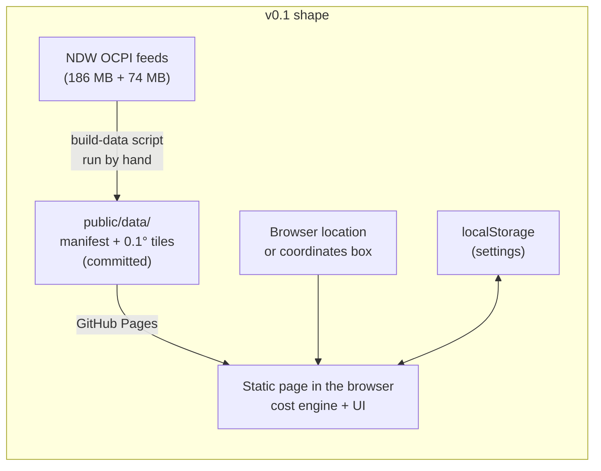
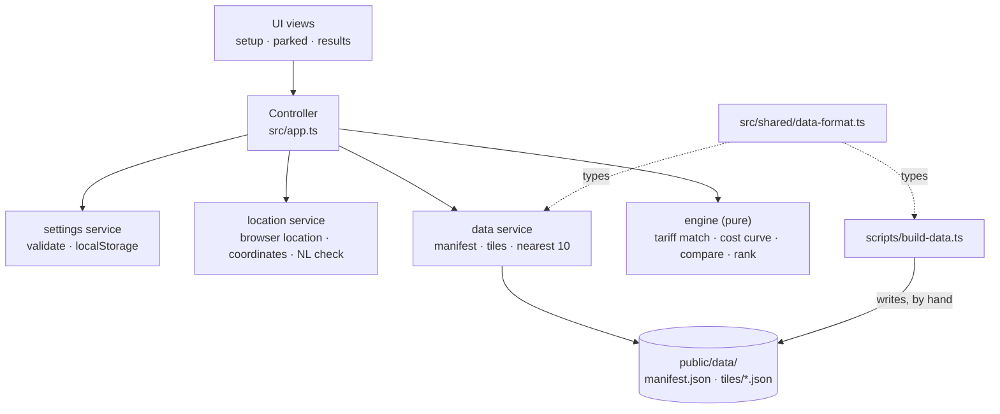

# Solution Design: Plug or Not — is charging here worth it? (v0.1 proof of concept)

**Date:** 2026-10-09
**Artifact:** solution-design
**Status:** Draft
**Template version:** default/0.3.1
**PRD:** [prd.md](prd.md)
**References:** NDW open data (https://opendata.ndw.nu/): `charging_point_locations_ocpi.json.gz`, `charging_point_tariffs_ocpi.json.gz`; OCPI 2.2.1 Tariffs module; GitHub repo `christianrexwinkel-tomtom/plug-or-not`
**Plugin version:** 0.5.3
**Agent Sessions:** claude-code: ce445151-30d9-4dc0-a993-0bd9b798394c
**Self-review:** Loop 3 (after the user's incomplete-data decision): CAP_REACHED — round-2 findings fixed, not re-reviewed. Findings: (1) a conditional `FLAT` fee (not matching at minute 0, or behind `min_duration`) could be silently dropped, producing a wrong "Worth it"; (2) pricing a shared tariff at the highest connector power is a guess that contradicted "charger power is never guessed" and "the one known exception"; (3) the ranking had no final tie-breaker for entries tying on saving, distance and tariff ID. Fixes: conditional non-zero `FLAT` makes the tariff `unreadable`; D-21 records highest published power as a stated exception in Key facts; location ID is the final tie-breaker. Loops 1 and 2 also ended at CAP_REACHED; their round-2 findings (9 and 6) were fixed.

---

> *Section audience —* 🔍 reviewer (understand the design without implementing it) · 🛠 author (implement the design). Sections without an icon serve both.

## Summary 🔍

Plug-in hybrid drivers can't tell at the charger whether a public AC (alternating current) session beats petrol, because tariffs mix kWh, time, parking and start fees. The PRD asks for a web page that ranks the 10 nearest Dutch chargers by saving, for the driver's car, battery level and stay. The design is a static web page with no server. A one-time, re-runnable Node script turns the NDW (Nationaal Dataportaal Wegverkeer) open-data feeds into small map tiles that are committed to the repo. GitHub Pages serves the page and the tiles. In the browser, a pure TypeScript cost engine simulates the session minute by minute over 24 hours, using the OCPI (Open Charge Point Interface) tariff rules. That one simulation yields the cost for every stay length, so the verdict, the saving, the ranking and the worth-it window all come from it. For v0.1, location comes from the browser plus a coordinates box. Address search is dropped, and the data is a snapshot refreshed by hand. Both are recorded as deviations from the PRD.

## Background & problem 🔍

The PRD settled what to build. Three technical facts, measured against the live feeds on 2026-10-09, shape how:

- **The feeds can't be read by a browser.** They send no CORS (cross-origin resource sharing) headers. They are also large: 17 MB compressed and 186 MB uncompressed for locations, 4 MB compressed and 74 MB uncompressed for tariffs. Trimmed to AC locations and the tariffs they use, they are still about 3.8 MB compressed — too much to load on a phone at the charger. The data must be pre-processed and split by area.
- **The tariffs are real OCPI, with real complexity.** Of 99,442 tariffs, the elements carry time-of-day windows (about 34,000), start and end dates (about 29,000), days of the week (about 9,000) and minimum or maximum session durations (about 3,400, e.g. "parking fee after 5 h"). There are four component types: `ENERGY`, `FLAT`, `TIME` and `PARKING_TIME`. The cost calculation has to apply these rules over the actual stay, not use a flat average.
- **The data has holes.** 74,128 locations have AC points. 10,126 of them list no tariff, and 2,407 reference a tariff ID that isn't in the tariff feed. Tariff IDs are unique only per operator (`party_id` + `id`); 5 bare IDs collide. These must surface as "Price unknown", never as a guessed price.

The repo is empty apart from the PRD, so this is a new build.

## Goals and non-goals

### Goals

**G1: Settings are entered once, validated and remembered** (realizes FR-001, FR-003, FR-004)
- [ ] G1-AC1 — The setup form accepts the seven settings in FR-001. It rejects empty or out-of-range values (FR-004 ranges) and blocks saving until all are valid. Messages follow the PRD's charging-speed pattern for every field: "Enter your {field} ({unit}) to continue." and "{Field} must be between {min} and {max} {unit}." — e.g. "Petrol price must be between 0.50 and 5.00 €/L." · `verify: Vitest on the settings validator — each field at min, max, min−ε, max+ε and empty`
- [ ] G1-AC2 — Comma decimals ("2,399") parse to 2.399 · `verify: Vitest on the number parser`
- [ ] G1-AC3 — Saved settings survive a reload in the same browser. When storage throws, the page works for the visit and shows "Your settings won't be remembered in this browser. You can still use Plug or Not now." · `verify: Vitest with a stub storage that throws; manual reload in Safari and Chrome`
- [ ] G1-AC4 — Changing only the petrol price leaves every other value unchanged · `verify: Vitest — save, change one field, read back (PRD S1 scenario 3)`

**G2: A trimmed, tiled data snapshot is built from the NDW feeds**
- [ ] G2-AC1 — `npm run build-data` downloads both feeds and writes `public/data/manifest.json` and `public/data/tiles/*.json`, with no raw feed data written anywhere under the repo · `verify: run the script; git status shows only public/data changes; no *.json.gz in the tree`
- [ ] G2-AC2 — Only locations with `publish` not false and at least one AC connector are kept (DC-only and unpublished locations dropped). Each kept location gets its entries by the entry rules in Architecture: one per resolved tariff ID, a `no-power` reason when none of that tariff's connectors publish power, and at most one `no-tariff` entry for any absent or unresolved tariff ID · `verify: Vitest on the transform with a fixture feed holding an AC-only, a DC-only and a mixed location, a location with one priced and one tariff-less connector, a connector listing one resolvable and one unresolvable ID (→ one priced entry plus one `no-tariff` entry), a tariff whose connectors publish no power (→ `no-power`), and an unpublished location (dropped)`
- [ ] G2-AC3 — Tariffs are joined on `party_id` + `id`. A missing or unresolvable tariff becomes an explicit "unknown" entry, never a dropped location · `verify: Vitest fixture with a colliding bare ID across two operators and an unresolvable ID`
- [ ] G2-AC4 — The manifest records the tariff feed's `Last-Modified` time as the data timestamp, and the page shows it (FR-019) · `verify: Vitest on the manifest writer; manual check on screen`

**G3: The driver's spot comes from the browser, or from typed coordinates** (realizes FR-006)
- [ ] G3-AC1 — "Use my location" calls the browser location API. Denied, unavailable or timed-out location shows "We couldn't get your location. Allow location access in your browser and try again, or enter coordinates below." with a "Try again" button · `verify: Vitest on the location wrapper with stubbed geolocation outcomes`
- [ ] G3-AC2 — A reported accuracy worse than 1,000 m shows "Your location is approximate" and points to the coordinates box (threshold from the PRD S5 edge case); results are still calculated and shown for the reported position · `verify: Vitest with a stub position at accuracy 1500 m`
- [ ] G3-AC3 — The coordinates box accepts "lat, lon" in decimal degrees (e.g. `51.4436, 5.5519`). Other input shows "Enter coordinates as latitude, longitude — for example 51.4436, 5.5519." and no results · `verify: Vitest on the coordinate parser`
- [ ] G3-AC4 — A spot outside the Netherlands border shows "Charger prices are available for the Netherlands only for now." and no list, for both location sources, with the coordinates box offered below the message · `verify: Vitest on the point-in-Netherlands check with Grand-Place Brussels (50.8467, 4.3525), a Dutch border town and Parkstraat Nuenen`

**G4: The 10 nearest AC locations are found from the tiles** (realizes FR-008, FR-009, FR-022)
- [ ] G4-AC1 — The page loads only the tiles around the spot, widening ring by ring until it has 10 locations and every unloaded tile is farther away than the 10th, or until every tile in the manifest is loaded. The result is the true 10 nearest by straight-line distance, however far (PRD S2 edge case "Only DC fast chargers nearby") · `verify: Vitest comparing the ring search with a brute-force nearest-10 over a fixture tile set, at a dense and a sparse spot`
- [ ] G4-AC2 — Each location keeps its distance in metres. A location with several distinct AC tariffs yields one entry per tariff and counts once towards the 10 · `verify: Vitest fixture with a two-tariff location`
- [ ] G4-AC3 — If a tile or the manifest can't be loaded, the page shows "Couldn't load charger prices. Check your connection and try again." with "Try again", and shows no partial list · `verify: Vitest with a fetch stub that fails on the third tile`

**G5: Session cost follows the OCPI tariff over the actual stay** (realizes FR-011–FR-014)
- [ ] G5-AC1 — The engine reproduces every PRD figure exactly (to the cent): S2 scenario 1 (€1.77, saving €0.39, 2.7 kWh), S2 scenario 4 (€2.38, 3.6 kWh), S2 scenario 5 (€6.80, 7.2 kWh, peak and off-peak split at 16:00) · `verify: Vitest with the PRD tariffs as fixtures`
- [ ] G5-AC2 — Charging power is the lower of the car's and the charger's maximum. Energy stops at the room left in the battery (90% of 15 kWh → 1.5 kWh) · `verify: Vitest — 22 kW charger with a 3.6 kW car; 11 kW car with a 3.7 kW charger; battery at 90%`
- [ ] G5-AC3 — Time-of-day and day-of-week windows are evaluated in Europe/Amsterdam time, including across midnight (Overnight from 21:00) · `verify: Vitest with an evening/night tariff and a start at 21:00, with the test process in a non-Dutch time zone`
- [ ] G5-AC4 — Trust guard: a tariff the engine can't fully interpret is "unknown", never priced with a part missing. That covers unsupported restriction types (`min_kwh`, `max_kwh`, `min_current`, `max_current`, `min_power`, `max_power`, `reservation`), no elements, a currency other than EUR, a conditional `FLAT` fee (non-zero `FLAT` with no element matching at minute 0, or behind a `min_duration`), an `ENERGY` gap during charging (a charging minute anywhere in the 1,440-minute simulation that no `ENERGY` element matches while the tariff has `ENERGY` elements), and a tariff whose `start_date_time`/`end_date_time` doesn't cover the whole 24-hour simulation from the session start (none of the tariffs in use carry an end date in the 2026-10-09 feed) · `verify: Vitest — one fixture per unknown cause, each asserting "unknown" and no cost`

**G6: Verdict, saving, worth-it window and ranking** (realizes FR-010, FR-015, FR-016, FR-020)
- [ ] G6-AC1 — The window is the shortest and longest stay, from 15 min to 24 h — 15 min, then every 10 minutes from 20 min, plus every stay the stepper can reach (multiples of 15 min) (D-20) — for which charging is cheaper than petrol (saving above €0, unrounded; D-19). Opcharge Zernikestraat shows "Worth it if you stay 1h30 to 7h30", Vattenfall Marconilaan "Worth it if you stay at least 40 min" and E-Flux Laboratoriumstraat "Never worth it: always more expensive than petrol for your car". A window starting at 15 min reads "Worth it for any stay" (this wording wins over "at least X" when the window also reaches 24 h), or "Worth it for any stay up to X" when its longest worth-it stay is under 24 h. A window whose longest worth-it stay is 24 h reads "at least X". A window with gaps adds "(not for every stay in between)" · `verify: Vitest with the PRD S4 tariffs`
- [ ] G6-AC2 — The verdict is "Worth it" when the saving at the chosen stay is above €0, unrounded (FR-016; D-19), "Not worth it for this stay" when it isn't but a window exists, "Never worth it" when there is no window, and "Price unknown" (no verdict, no window) for unknown tariffs · `verify: Vitest table test over the four cases`
- [ ] G6-AC3 — Entries are ordered by unrounded saving, biggest first; exactly equal savings go to the nearer location, then by tariff ID for a deterministic order; and unknown entries last, by distance, then `no-tariff` after other reasons, then tariff ID; location ID is the final tie-breaker for every entry ·  `verify: Vitest on the ranking`
- [ ] G6-AC4 — A full battery (100%) shows "Your battery is full, so there's nothing to charge here." and lists no savings · `verify: Vitest on the results builder`
- [ ] G6-AC5 — Each entry shows operator, address, distance in metres, price summary, verdict, saving or extra cost (€), cost per km next to petrol cost per km, kWh added and the window (FR-015). All prices are shown including VAT, rounded half-up to cents; a positive saving below €0.005 shows as "saves less than €0.01", and an extra cost below €0.005 as "costs less than €0.01 more" (D-19) · `verify: Vitest on the entry view model with the Nuenen fixture (cost per km €0.16/km next to petrol €0.20/km)`
- [ ] G6-AC6 — The price summary lists the components in force at the session start, including VAT, in the order kWh, per hour while charging, per hour after full, start fee, labelled "/kWh", "/h charging", "/h after full" and "start". Examples: Vattenfall Marconilaan "€0.33/kWh"; Opcharge Zernikestraat "€0.52/kWh · €0.61/h after full · €0.61 start"; E-Flux Het Voorburg at 15:30 "€0.66/kWh · €0.50/h charging · price varies by time". It adds "· price varies by time" when other elements apply at other times or durations. Card fees aren't part of the summary: it describes the operator's price, and the card fees are in the settings. Unknown entries of any reason show no price summary, only "Price unknown" and the G6-AC7 reason · `verify: Vitest on the summary formatter with the Vattenfall, Opcharge and Culemborg PRD tariffs`
- [ ] G6-AC7 — Every "Price unknown" entry says what's missing, with no cost, saving, kWh, cost per km, verdict or window: "No price published for this charger." (no or unresolvable tariff), "Charging power isn't published for this charger." (D-18), or "The published price is incomplete or can't be read." (every other G5-AC4 cause) · `verify: Vitest on the entry view model, one case per reason`

**G7: The "parked here now" screen updates live** (realizes FR-005, FR-017, FR-018, FR-021)
- [ ] G7-AC1 — The screen asks for the battery level (0–100%), blocks the request on missing or invalid input with "Enter your current battery level (0–100%).", and opens the setup with "Set up your car first so we can calculate your costs." when settings are missing · `verify: Vitest on the screen controller; manual check`
- [ ] G7-AC2 — Picking an event type sets the PRD stay (Meeting → 2h30). The default is Shopping (1h30). Adjusting the stay shows "Shopping (adjusted)" · `verify: Vitest on the stay model`
- [ ] G7-AC3 — The stay moves in 15-minute steps and stops at 15 min and 24 h with "Stays can be 15 minutes to 24 hours." · `verify: Vitest on the stay model`
- [ ] G7-AC4 — Changing the stay re-ranks and re-renders from the already-computed cost curves, without refetching and without a spinner. Changing the battery level recomputes the curves · `verify: Vitest asserting no fetch and no engine run on stay change; manual check on a phone`
- [ ] G7-AC5 — While the spot, tiles and curves are being resolved, the screen shows "Finding chargers near you…", and each entry appears complete, window included, never in parts · `verify: Vitest on the controller state sequence (idle → finding → results)`

**G8: Opened from a link, answer within 30 seconds**
- [ ] G8-AC1 — A push to `main` builds and deploys to GitHub Pages over HTTPS, with no install for the viewer · `verify: open the Pages link on an iPhone (Safari) and an Android phone (Chrome)`
- [ ] G8-AC2 — From opening the page with saved settings to the answer on screen takes under 30 seconds, measured in 5 stopwatch trials on a phone over mobile data · `verify: manual stopwatch run (PRD success metric)`

### Non-goals

- Address or place search (dropped for v0.1, see Deviations).
- Scheduled or automatic data refresh. The snapshot is refreshed by hand.
- A server, an API or a database of any kind.
- Charging losses (PRD D-16), live availability, DC chargers, card subscriptions.
- Feed-provided VAT rates and `step_size` billing increments. FR-011 fixes 21% VAT and per-minute time billing, so both feed fields are ignored.
- Automated browser end-to-end tests. The engine and controllers are unit-tested, and the device checks are manual.
- Remembering the last event type (FR-023, fast-follow).

## Architecture

The system has two halves that share one data format: an offline **data build** and an online **static page**.

**Data build (Node, run by hand).** `scripts/build-data.ts` streams both NDW feeds into memory, never to disk inside the repo. It keeps locations whose `publish` flag isn't false (1,451 unpublished locations dropped in the 2026-10-09 feed) and that have at least one AC connector, and joins each AC connector's `tariff_ids` to tariffs on `party_id` + `id`. **Entry rules**, the one place they are defined: (a) one entry per distinct resolved tariff ID, carrying the highest power among the AC connectors that use it *and* publish one. A connector's power is `max_electric_power` (W), or else `max_voltage` × `max_amperage` (× 3 for `AC_3_PHASE`). (b) If none of those connectors publish power (4 locations in the 2026-10-09 feed), that entry gets reason `no-power` (D-18). (c) If any AC connector lists no tariff IDs, or any listed ID doesn't resolve — even next to one that does — the location gets exactly one extra entry with reason `no-tariff`. A missing tariff is shown, never silently dropped (FR-020, FR-022; 2,073 locations mix priced and unpriced connectors). The reason is stored on the entry in the tile (`unknown: "no-tariff" | "no-power"`); the engine adds the third reason, `unreadable`, for the G5-AC4 causes. Locations are bucketed into 0.1° × 0.1° tiles (about 11 × 7 km in the Netherlands) by floor of latitude and longitude. Each tile file carries its locations and a copy of only the tariffs they reference. The script doesn't interpret tariffs: it copies the OCPI `elements` plus the tariff-level `currency`, `start_date_time` and `end_date_time`, so all pricing logic lives in one place, the engine. It writes `public/data/manifest.json` with the tile size, the list of tile keys that exist, and the tariff feed's `Last-Modified` time. Running it replaces `public/data/` entirely, and the developer commits the result.

**Static page (browser, TypeScript, built by Vite).** The page has four layers. The UI calls only the controller; the controller calls the services and the engine; services call only the browser APIs and `fetch`; the engine calls nothing:

1. **UI** (`src/ui/`) — three views: setup, "parked here now" (battery, stay, location) and results. Plain DOM rendering from a small app state, no framework.
2. **Controller** (`src/app.ts`) — owns app state and the request flow: settings → spot → Netherlands check → tiles → nearest 10 → cost curves → results. It keeps the computed cost curves, so a stay change only re-reads them.
3. **Services** — `settings` (validation, localStorage), `location` (browser location, coordinate parsing, Netherlands border check) and `data` (manifest and tile fetching, ring search for the nearest 10).
4. **Engine** (`src/engine/`) — pure functions, no DOM, no fetch, no clock. The caller passes in "now".

**The cost engine — one simulation per entry.** For one tariff entry, the engine walks the 1,440 minutes from the start time. In each minute it knows the elapsed time, the local wall-clock time and day (Europe/Amsterdam), and whether the car is still charging. A minute's energy is the lower of power ÷ 60 and the room left. The car is charging while delivered energy is below the room, where power = min(car kW, charger kW) and room = battery kWh × (1 − level). For each component type, the engine applies the OCPI rule: the **first** element whose restrictions all match prices that component for that minute. `ENERGY` × the minute's kWh; `TIME` × 1/60 h while charging; `PARKING_TIME` × 1/60 h while not charging; `FLAT` once, from the first element matching at minute 0; if no `FLAT` element matches at minute 0 but a non-zero `FLAT` price exists, or a non-zero `FLAT` price sits in an element with a `min_duration`, the tariff is `unreadable` (G5-AC4), because a conditional start fee would otherwise be silently dropped. If no element matches `TIME`, `PARKING_TIME` or `FLAT` in a minute, that component costs nothing in that minute (OCPI semantics — e.g. free parking at night). `ENERGY` is the exception: if the tariff has any `ENERGY` component but a charging minute anywhere in the 1,440-minute simulation matches none (independent of the chosen stay, so a stay change never changes it), the entry is "Price unknown" (G5-AC4), because free kWh is far more likely a data gap than a real price. **Rounding:** money stays unrounded in the curve; anything shown is rounded half-up to cents after adding 1e-9 (so €0.605 shows as €0.61), never with `toFixed` directly. Every tariff price gets × 1.21 for VAT, and the card start fee and per-kWh markup are added as entered, with no VAT. The output is a **cost curve**: cumulative cost and cumulative kWh at the end of every minute 1…1440.

Because every stay starts at the same moment, the cost of a stay of *T* minutes is just the curve at *T*. Everything else is a read of the curve:

- petrol cost(T) = kWh(T) ÷ electric kWh/km ÷ petrol km/L × petrol €/L
- saving(T) = petrol cost(T) − charge cost(T)
- window = the smallest and largest *T* in the grid {15, 20, 30, 40, 45, 50, 60, …, 1440} — multiples of 10 or 15 min (D-20) — with saving(T) > 0 (D-19). Every stay the stepper can reach is on the grid, so the verdict never contradicts the window edges. If some stays between those edges aren't worth it (possible with time-of-day or duration rules), the window sentence adds "(not for every stay in between)", and the verdict always comes from the chosen stay itself
- verdict, cost per km and the ranking at the chosen stay follow directly

`min_duration` and `max_duration` restrictions are read against elapsed time in the session, which is how the feed uses them: for example, "the parking rate applies after 18,000 s".

**Nearest-10 search.** From the spot's tile, the data service loads rings of tiles (ring 0 = 1 tile, ring 1 = the 3 × 3 block, …). The manifest says which tile keys exist, so empty tiles aren't fetched. It stops when it has at least 10 locations and the 10th-nearest is closer than the nearest edge of the loaded block, which guarantees the true 10 nearest. Distance is haversine, in metres. There is no ring cap: the search also stops once the loaded block covers the manifest's full tile extent, so it always returns the 10 nearest, however far. With about 74,000 locations that extent is never reached in practice.

## Components

- **`package.json`, `tsconfig.json`, `vite.config.ts`** — TypeScript, Vite and Vitest toolchain. The Vite `base` is `/plug-or-not/` for GitHub Pages. Scripts: `dev`, `build`, `test`, `build-data`.
- **`index.html`** — page shell, three view containers, mobile viewport meta.
- **`.github/workflows/deploy.yml`** — on push to `main`: install, test, build, and deploy `dist/` to GitHub Pages.
- **`src/shared/data-format.ts`** — types for the manifest, tiles, locations, entries and the OCPI tariff subset. Imported by both the script and the page.
- **`scripts/build-data.ts`** — fetch both feeds, trim, join, tile, write `public/data/`. Pure transform functions are exported for tests.
- **`public/data/`** — the committed snapshot: `manifest.json` and `tiles/{latKey}_{lonKey}.json`.
- **`src/engine/tariff.ts`** — checks that a tariff is interpretable (the G5-AC4 causes), and matches restrictions for a given minute (time of day, day of week, date, elapsed duration).
- **`src/engine/curve.ts`** — the per-minute simulation that produces the cost curve for one entry.
- **`src/engine/compare.ts`** — petrol cost, saving, verdict, window and ranking, built from cost curves and the stay.
- **`src/services/settings.ts`** — settings schema, ranges, number parsing (comma decimals), and versioned localStorage (`plugornot.settings.v1`) with a fallback when storage is unavailable.
- **`src/services/location.ts`** — browser location wrapper (10 s timeout, accuracy check), "lat, lon" parser, and point-in-Netherlands check.
- **`src/services/nl-border.ts`** — a simplified Netherlands land border polygon (from Natural Earth, public domain), a few kB.
- **`src/services/data.ts`** — manifest and tile fetch with all-or-nothing failure, haversine distance, ring search for the nearest 10, and entry expansion.
- **`src/app.ts`** — the controller: app state, the request flow, and the cached cost curves for live stay changes.
- **`src/ui/setup.ts`, `src/ui/parked.ts`, `src/ui/results.ts`** — the three views, all user-facing messages, and the event-type picker and stay stepper.
- **`src/ui/format.ts`** — euros, kWh, metres, durations ("1h30", "40 min"), the window sentence, and the price summary built from the tariff's elements (G6-AC6).
- **`src/main.ts`** — wires the views to the controller on load.
- **Tests** — `*.test.ts` next to each engine and service file. `test/fixtures/prd-tariffs.ts` holds the PRD's named tariffs, and `test/fixtures/feeds/` a small locations and tariffs feed for the script.

## Data flow

1. **Open the page.** `settings` reads localStorage. With no settings, the setup view opens; otherwise, the parked view.
2. **Choose a spot.** "Use my location" → browser location (10 s timeout), or "lat, lon" typed in the coordinates box. The spot is checked against the Netherlands border before any data loads. The spot stays in memory only.
3. **Load data.** `data` fetches `manifest.json`, then rings of tiles, until the nearest-10 guarantee holds. Any failed fetch fails the whole request.
4. **Compute.** For each entry (10 locations expand to 10 or more entries), the engine builds a cost curve from "now", the battery level and the settings: 1,440 minutes × at most about 20 entries, a few milliseconds.
5. **Render.** `compare` reads each curve at the chosen stay for the verdict, saving, cost per km and kWh. It reads the window grid (multiples of 10 or 15 min, D-20) for the window, then ranks. The results view renders the list and the data timestamp.
6. **Stay change.** Back to step 5 only. **Battery change.** Back to step 4. **New spot.** Back to step 3.

## Error handling

The PRD's error tables are covered by the acceptance criteria in G1, G3, G4, G6 and G7. Failure modes that are new in this design:

- **A tile file is missing for a key the manifest lists** (a partial commit): the same "Couldn't load charger prices…" message as a network failure. No partial list.
- **The page loads a manifest with an unknown format version** (an old cached page after a format change): the same load-failure message. The manifest carries `formatVersion`, and the page checks it.
- **The build script hits a feed download or JSON parse failure**: it exits non-zero, before writing anything, and leaves `public/data/` untouched.

## Testing & verification

- **PRD scenarios as engine fixtures.** Every numbered PRD figure (S2 scenarios 1, 4 and 5; S4 scenarios 1 and 3; the edge-case table rows with numbers) becomes one Vitest case against `test/fixtures/prd-tariffs.ts`, asserting to the cent and to the minute. These are the regression net for the trust guardrail.
- **Time zone independence.** The engine test suite runs with `TZ=America/New_York`, so a hidden dependency on the machine's local time fails the tests.
- **Live-snapshot smoke check.** After each `build-data` run, a Vitest case loads the real tiles at Parkstraat Nuenen (51.4436, 5.5519) and Klokgebouw Eindhoven (51.4484, 5.4573). It asserts 10 locations, at least one priced entry and no thrown errors. It reports, without failing, the share of entries that came out "unknown".
- **Real-bill accuracy (PRD success metric).** Refresh the snapshot shortly before each of the 5 sessions you compare. Run each session through the engine in a Vitest case, with that charger's snapshot tariff, the battery level at plug-in, the real start time and the real stay, and compare with the invoice (target: within €0.25). The page itself always starts the session at "now", so it can't replay a past session.
- **Devices.** Manual check on iPhone Safari, Android Chrome, and desktop Chrome, Edge and Safari. Cover the location prompt, the stopwatch metric (G8-AC2) and the storage-blocked notice in a private window.

## Decisions 🔍

| ID | Title | Context | Options | Choice | Rationale | Source | Goal impact | Consequences |
|----|-------|---------|---------|--------|-----------|--------|-------------|--------------|
| D-1 | One-time data snapshot | The NDW feeds can't be read from a browser (no CORS) and are too large for a phone | Scheduled job building tiles every 6 h; serverless function answering nearest-10; one-time snapshot committed to the repo | One-time snapshot, built by a re-runnable script and refreshed by hand | User: good enough for a PoC; no scheduler or server to run | user | G2 | Tariff data ages from the snapshot date (deviation from the 24-hour NFR). Refresh before demos and accuracy sessions |
| D-2 | Commit only pre-processed data | The raw feeds are 260 MB uncompressed | Commit raw and processed; commit processed only | Only `public/data/` (tiles and manifest) is committed. Raw feeds stay in memory during the build | User | user | G2-AC1 | Repo stays small. Rebuilding needs network access to NDW |
| D-3 | No address search in v0.1 | PRD S5 and FR-007 asked for EU/US address search; a provider had to be chosen | TomTom Search API; Photon; both; none | None. Location comes from the browser only, plus D-4 | User: PoC scope | user | G3 | Story 5 and FR-007 are dropped (deviation). No API key or third-party service |
| D-4 | Coordinates box for demos and testing | Without address search, there was no way to check a spot you aren't at | Hidden URL parameter; nothing; coordinates input box | A visible "Use a different spot" box taking "lat, lon" | User preferred an input box over a URL parameter | user | G3-AC3, G3-AC4 | PRD scenarios can be reproduced in a real browser. Drivers who deny location still have a way in |
| D-5 | Host on GitHub Pages | The PRD needs free hosting reachable by a link; location needs HTTPS | GitHub Pages; Netlify or Cloudflare Pages; defer | GitHub Pages from `christianrexwinkel-tomtom/plug-or-not`, deployed by GitHub Actions | User | user | G8-AC1 | The repo must be public (personal account without GitHub Pro). Switching host later only touches the workflow and the Vite `base` |
| D-6 | TypeScript + Vite, no UI framework | Empty repo; the toolchain had to be chosen | TS + Vite + Vitest; TS + Vite + Preact; plain JS, no build | TypeScript, Vite, Vitest, plain DOM | User. Types guard the unit-heavy cost maths, and one shared type file keeps the script and the page in sync | user | all | npm only for developers; viewers just open the link |
| D-7 | 0.1° tiles | A phone must load only nearby data | Single file; per-city files; fixed-degree grid | 0.1° × 0.1° tiles plus a manifest of existing keys | Tiny per-request download in cities; ring search gives exact nearest-10 anywhere | auto (feed profile: 3.8 MB compressed total) | G4-AC1 | Rural spots may load several rings; still small |
| D-8 | Tariffs interpreted only in the browser | Pricing logic could live in the build script or in the page | Pre-compute prices in the script; copy OCPI elements and interpret in the page | Script copies elements; the engine interprets | Prices depend on battery, stay and start time, so they can't be pre-computed; one interpreter means one place to test | auto (PRD FR-011) | G5 | Tiles carry raw OCPI elements (deduplicated per tile) |
| D-9 | Join tariffs on `party_id` + `id` | 5 bare tariff IDs collide across operators | Bare `id`; `party_id` + `id` | `party_id` + `id`, with the location's `party_id` | Zero collisions on the composite key in the 2026-10-09 feed | auto (feed profile) | G2-AC3 | A wrong join would silently price a charger with another operator's tariff |
| D-10 | Per-minute cost curve | Time windows, elapsed-duration rules and the charging-to-full switch make cost non-linear in stay | Closed-form per segment; per-minute simulation | Simulate 1,440 minutes once per entry; read every stay off the curve | Simple and exact at minute resolution (FR-011 bills time per minute); a few ms per entry | auto (PRD FR-011, FR-016) | G5, G6, G7-AC4 | Stay changes are free; battery changes recompute |
| D-11 | OCPI first-match per component; durations as elapsed time | OCPI picks, per component type, the first element whose restrictions match; `min_duration` and `max_duration` need a reading | Total session length; elapsed time in the session | First match per component per minute; durations against elapsed time | Matches the feed's use (e.g. a parking rate from 18,000 s) and the PRD's Opcharge window | auto (OCPI 2.2.1; feed samples) | G5-AC1, G6-AC1 | One-off restrictions with a different meaning would be mispriced; caught by the real-bill check |
| D-12 | Unsupported restrictions mean "unknown" | A few elements use kWh, current, power or reservation restrictions | Ignore them; approximate them; treat the tariff as unknown | Unknown ("Price unknown") | The PRD guardrail forbids a wrong "Worth it"; these are rare (under 30 elements) | auto (PRD FR-020, guardrail metric) | G5-AC4 | A handful of chargers show "Price unknown" |
| D-13 | Always 21% VAT; ignore the feed's `vat` field | The feed sometimes states a VAT rate (21, 0, 8.5, 20) | Use the feed's rate when present; always 21% | Always 21% on every tariff component, including `FLAT` | FR-011 and PRD D-15 say so; the PRD's Opcharge window upper edge (7h30) only matches with VAT on the €0.50 start fee — without it, it would be 7h40 | auto (PRD FR-011, D-15) | G5-AC1 | The rare non-21% components are priced at 21% |
| D-14 | Ignore `step_size` | Some components bill in 60 s or 900 s steps | Honour `step_size`; per minute | Time billed per minute, energy per Wh | FR-011 fixes per-minute time billing | auto (PRD FR-011) | G5 | Slight under-pricing for 15-minute-block tariffs; caught by the real-bill check |
| D-15 | Netherlands check by border polygon | Without address search there's no country code; the spot needs a coverage check | Reverse geocoding; "is there a tile here"; bundled border polygon | Simplified Natural Earth polygon, point-in-polygon | No service needed; a tile check would wrongly accept Belgian border towns | auto (D-3) | G3-AC4 | A spot within the polygon's simplification tolerance of the border may be misjudged |
| D-16 | Amsterdam time for tariffs | Time-of-day prices must follow Dutch wall-clock time | Device time zone; Europe/Amsterdam | Europe/Amsterdam via `Intl.DateTimeFormat` | Every covered charger is in the Netherlands (feed `time_zone`) | auto (feed) | G5-AC3 | A demo laptop set to another time zone still prices correctly |
| D-17 | Unit tests plus manual device checks | Choose the test depth for a PoC | Unit only; unit plus Playwright end to end; unit plus manual | Vitest for engine, services and controller; manual device checks | The risk sits in the calculation, which unit tests cover fully | auto (PoC scope) | all `verify:` hints | UI regressions are found by hand |
| D-18 | Unknown charger power means "Price unknown" | A few AC connectors publish no power, voltage or amperage, and kWh added depends on it | Assume 3.7 kW; price at two powers and keep the lower saving; "Price unknown" | "Price unknown" | Any guessed power can overstate the saving (a low guess delays parking fees, a high one inflates kWh, and real points can be below 3.7 kW); the PRD guardrail forbids a wrong "Worth it" | user ("If a charge has incomplete data, mention it to the user and don't include a price calculation"); feed profile: 4 locations | G2-AC2, G5-AC4, G6-AC7 | 4 locations show "Price unknown" with the reason; FR-020 widened (see Deviations) |
| D-19 | Worth-it on the unrounded saving; tiny savings labelled | An unrounded saving of €0.003 would show "Worth it" next to "€0.00" | Unrounded > 0; rounded to cents ≥ €0.01 | Unrounded saving > 0 decides verdict and window (FR-016's "cheaper than petrol"); a saving below €0.005 displays as "saves less than €0.01" | Keeps FR-016 literal while what's shown never reads "Worth it · saves €0.00"; every PRD window reproduces (Opcharge saves €0.0136 at 1h30 and €0.0077 at 7h30) | auto (PRD FR-016) | G6-AC1, G6-AC2, G6-AC5 | A marginal entry can read "Worth it" next to "saves less than €0.01", or "Not worth it" next to "costs less than €0.01 more" |
| D-20 | Window in 10-minute steps | PRD FR-016 and PRD D-19 set 5-minute window steps | 5-minute; 10-minute; 15-minute (same as the stay stepper) | 15 min (the minimum stay), then multiples of 10 minutes from 20 min to 24 h, plus every multiple of 15 min the stay stepper can reach | User asked for 10-minute steps in design review; multiples of 10 read naturally ("1h30", "40 min"), and keeping 15 min as the first point means "Worth it for any stay" still starts at the minimum stay; adding the stepper's 15-minute stays (auto, from design self-review) keeps the window and the verdict from contradicting each other at a stay like 45 min | user | G6-AC1 | Marconilaan becomes "at least 40 min" (was 35) and the PRD S4 edge-case 1h05 becomes 1h10; Opcharge 1h30 to 7h30 is unchanged |
| D-21 | Highest published power for a shared tariff | One tariff can cover connectors of different power at one location, but FR-022 asks for one entry per tariff | Highest; lowest; one entry per power | Highest published power among the connectors using that tariff | The driver picks the best free point; neither the lowest nor the highest is safe for every tariff (low power delays parking fees, high power inflates kWh), and splitting entries by power goes beyond FR-022 | auto (FR-022) | G2-AC2, G5-AC2 | If the driver uses a slower point than listed, the saving can be overstated; listed as an exception to the one rule in Key facts |

## Deviations from PRD 🔍

| ID | Type | Status | PRD updated? | Note |
|----|------|--------|--------------|------|
| NFR "Tariff data no older than 24 hours" | change | approved | yes — PRD §Non-Functional Requirements edited 2026-10-09 | D-1: v0.1 uses a one-time snapshot refreshed by hand before demos and accuracy sessions. The data date stays on screen (FR-019) |
| FR-007, Story 5 | change | approved | yes — PRD §User Stories table, §Story 2 edge cases, §Story 5, §FR-007, §Release Slicing, §Dependencies, §Out of Scope, §Decisions D-9 and D-21 edited 2026-10-09 | D-3: no address search in v0.1. D-4 adds a coordinates box in its place |
| FR-021, S2 error table "Outside coverage" | change | approved | yes — PRD §FR-021, §Story 2 error table edited 2026-10-09 | Follows from D-3: no "no address match" message. The location-denied message points to the coordinates box instead of address search |
| FR-016, PRD D-19 | change | approved | yes — PRD §FR-016, §Story 4 scenario 1, §Story 4 edge cases, §Decisions D-19 edited 2026-10-09 | D-20: the worth-it window uses 10-minute steps (after the 15-minute minimum, plus the stepper's 15-minute stays) instead of 5-minute steps, at the user's request in design review. Marconilaan reads "at least 40 min", and the edge case's window starts at 1h10 |
| FR-020 | change | approved | yes — PRD §FR-020 edited 2026-10-09 | D-18: "Price unknown" covers every charger with incomplete data — tariff missing or unreadable, or charger power not published — and the entry says what's missing, with no price calculation. User: "If a charge has incomplete data, mention it to the user and don't include a price calculation" |

## Key facts & assumptions

- **The one rule:** never show "Worth it" on a guess. Any tariff part the engine can't interpret makes the whole entry "Price unknown" (D-12, G5-AC4). Two known exceptions: a tariff shared by connectors of different power is priced at the highest published power (D-21), and `step_size` is ignored (missing charger power is never guessed: D-18) — ignored because FR-011 fixes per-minute time billing (D-14). In the 2026-10-09 feed, only 2 components use steps longer than a minute (900 s); the real-bill check is the backstop.
- **Feed prices exclude VAT** (PRD D-15, still unconfirmed by NDW). The PRD's worked examples only reproduce under this reading, including VAT on the start fee.
- **OCPI semantics** (D-11) are inferred from the spec and feed samples, not confirmed per operator. The 5-session real-bill check is the validation.
- **Public access:** every NDW location with `publish` not false is treated as public (FR-008); restricted access isn't otherwise modelled in the feed.
- **Snapshot size:** about 74,000 AC locations and 13,000 referenced tariffs, about 3.8 MB compressed across all tiles (measured 2026-10-09). Git handles this comfortably for a PoC.
